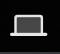
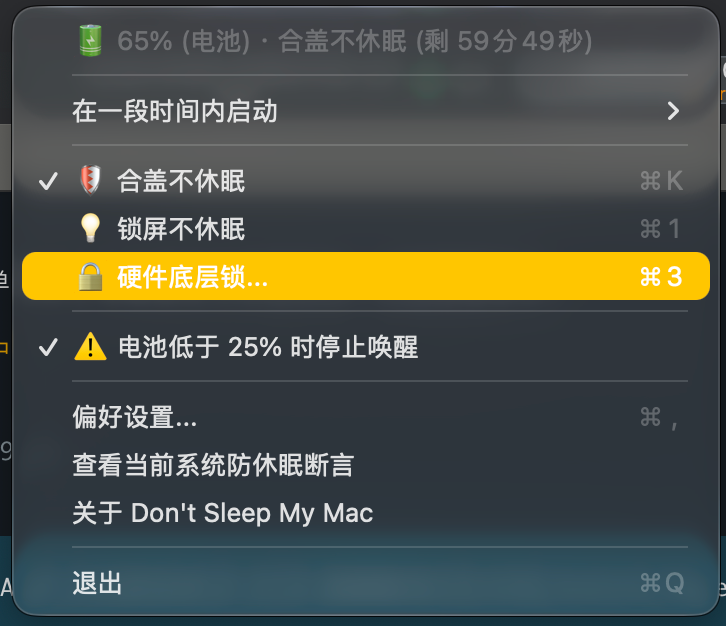

# Don't Sleep My Mac

轻量的 macOS 菜单栏防休眠工具。锁屏继续工作，按需保持合盖运行，也可以设置持续时间和低电量停止条件。

本仓库提供软件介绍、界面图片和安装包，不公开源码。

## 下载与安装

前往 [最新版本](https://github.com/yzxq1/DontSleepMyMac/releases/latest) 下载 Apple Silicon 版 DMG，打开后将 `DontSleepMyMac.app` 拖入「应用程序」。

首次打开如被 macOS 拦截，请确认安装包来自本发布页，再到「系统设置 → 隐私与安全性」中允许打开。

## 功能

| 功能 | 说明 |
| --- | --- |
| 锁屏不休眠 | 开盖锁屏或闲置时保持系统运行，便于后台下载、编译等任务继续进行。 |
| 合盖不休眠 | 在支持的机型与系统环境下，合盖后继续运行后台任务。 |
| 硬件底层锁 | 通过系统电源设置禁用休眠，启用和恢复需要管理员权限。 |
| 定时保持唤醒 | 支持无限期、5／10／15／30 分钟，以及 1／2／5 小时。到期后停止保持唤醒。 |
| 实时状态 | 菜单顶部两行分别显示电量与供电状态、当前模式与剩余时间。 |
| 电量阈值 | 默认电量阈值为 25%，可在偏好设置中调整；电池供电达到停止条件时结束保持唤醒。 |
| 启动设置 | 可设置登录时启动，以及打开软件时是否立即开启防休眠。 |
| 状态查看 | 保留系统防休眠断言查看窗口和关于页面。 |

## 使用方式

- **左键点击菜单栏图标**：开启或停止保持唤醒。
- **右键点击菜单栏图标**：打开菜单，选择模式和持续时间。
- **在一段时间内启动**：选择本次保持唤醒的时间。
- **偏好设置**：调整启动行为和电池电量阈值。

停止保持唤醒后，系统恢复原有休眠策略。合盖运行的实际效果取决于机型、macOS 版本及外接设备；运行时请保持通风。

## 界面预览

菜单栏采用简洁的笔记本图标：

菜单包含模式选择、定时时长、电量停止条件与偏好设置：

*上图为此前版本的界面截图；当前版本已将顶部电量与模式、剩余时间分为两行，减少菜单宽度。*

## 许可声明

本项目未授予源码或安装包的开源许可。未经作者许可，不得修改、再分发或商业销售。
